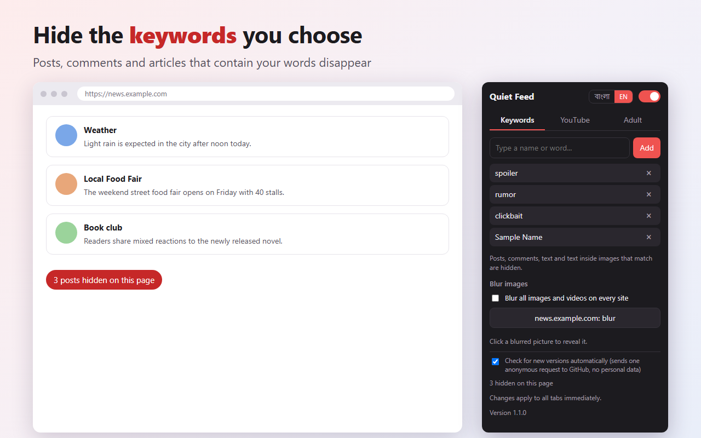
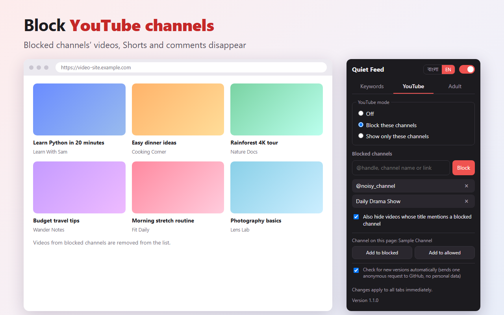
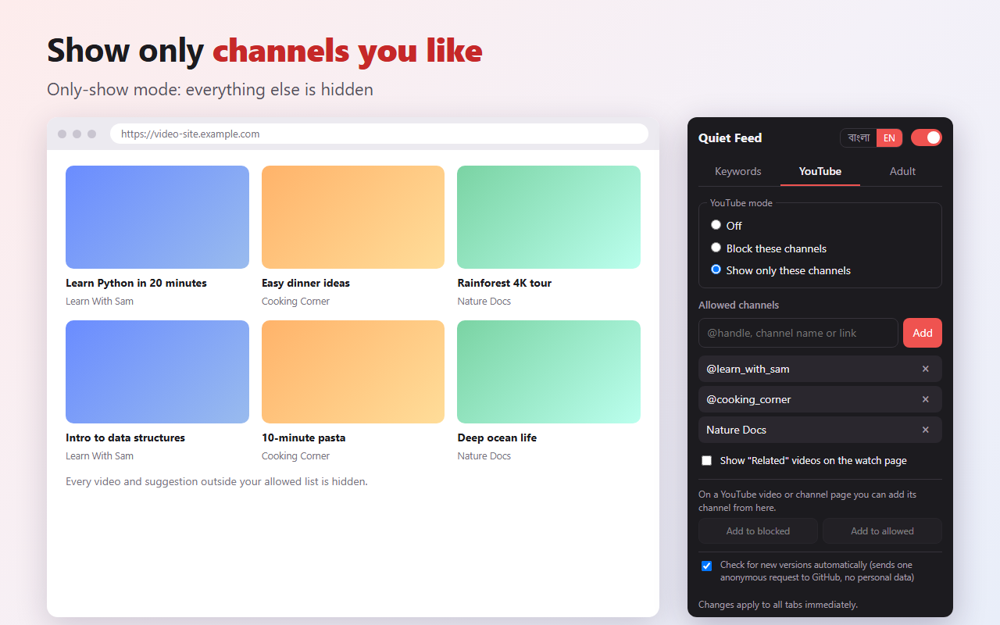
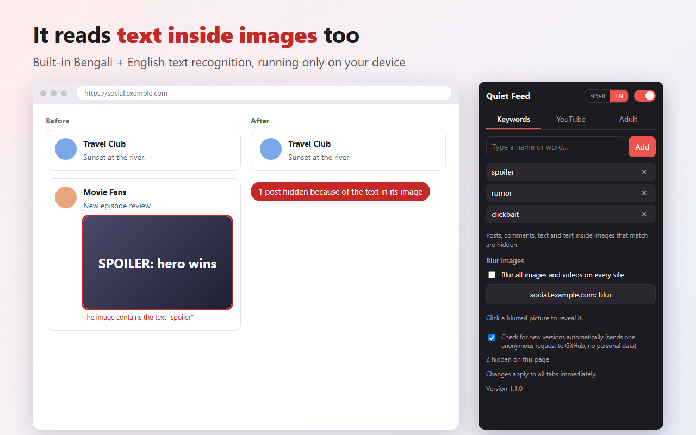

# Quiet Feed – Keyword & Channel Filter

**[বাংলা](README.md) | English**

<p align="center">
  <b>Works on all major browsers</b><br>
  
  
  
  
  
  
  <br>
  <sub>Chrome, Edge, Brave, Opera, Vivaldi and Arc use the same ZIP (all Chromium-based). Firefox has its own ZIP.</sub>
</p>


Quiet Feed hides posts, comments, articles and images that contain the names or keywords you choose, on any website. It can also block YouTube channels, or show only the channels you pick. Everything runs inside your browser. No data leaves your device.



## Features
- **Keyword filter:** hides posts, comments and articles on Facebook, X, Reddit, blogs, news sites and any other page when they contain a word or name from your list. Works with Bengali and English text.
- **Text inside images:** reads text in pictures (news cards, memes, screenshots) with a bundled Bengali + English OCR and hides the image if it matches. Runs on your device.
- **YouTube channel blocker:** videos, Shorts, comments and channel pages of blocked channels disappear.
- **"Only show" mode on YouTube:** pick the channels you want to see and everything else is hidden.
- **Related-content control:** optionally hide videos that mention a blocked channel in the title. In only-show mode, keep or hide the "Related" sidebar.
- **Blur mode:** blur all images and videos, everywhere or only on the sites you choose. Click a picture to reveal it.
- **Adult content filter (optional):** hides posts, comments, articles and image text that contain adult words (English and Bengali), hides YouTube videos and channels whose name or title match them, blocks well-known adult websites, and keeps Google, Bing and DuckDuckGo in SafeSearch. Turn it on in the **Adult** tab. It is separate from your own filters, so turning it on or off never affects them. By default hidden items have a **Show** button, and blocked sites have **Show anyway**; turn that option off for strict mode.
- **Update notice:** a banner in the popup and a NEW badge tell you when a newer release is on GitHub.
- **Bengali / English interface:** switch the popup language at any time.
- **One-click add:** add the current YouTube channel from its video or channel page.

| YouTube block | Only-show mode | Text in images |
|---|---|---|
|  |  |  |

## Install (Chrome, Edge, Brave, Opera, Vivaldi, Arc)
Quiet Feed is not in any extension store yet, so you load it yourself. It takes about two minutes.

1. Download `quiet-feed-chromium-*.zip` from the [Releases](../../releases) page.
2. **Extract** the ZIP into a folder. A ZIP cannot be loaded directly. Keep the folder somewhere you will not delete it later.
3. Open your browser's extensions page:
   - Chrome: `chrome://extensions`
   - Edge: `edge://extensions`
   - Brave: `brave://extensions`
   - Opera: `opera://extensions`
   - Vivaldi: `vivaldi://extensions`
4. Turn on **Developer mode**.
5. Click **Load unpacked** and select the extracted folder.
6. Pin **Quiet Feed** from the toolbar's Extensions (puzzle) menu.

> Chrome may sometimes show a "Disable developer mode extensions" notice. It appears for every extension installed outside the store. You can dismiss it.

## Install (Firefox)
Firefox loads extensions from outside the store **temporarily** only. They are removed when you close the browser.

1. Download `quiet-feed-firefox-*.zip` from Releases.
2. Open `about:debugging#/runtime/this-firefox`.
3. Click **Load Temporary Add-on...** and select the ZIP file (or the `manifest.json` inside the extracted folder).
4. Allow access to all websites when asked.

To keep it permanently, use Firefox Developer Edition or Nightly and set `xpinstall.signing.required` to `false`.

## How to use
- Click the extension icon.
- On the **Keywords** tab, type a name or word and press **Add**. It takes effect immediately in every tab.
- On the **YouTube** tab, choose a mode: Off, Block, or Only show. To add a channel, enter an `@handle`, a channel name or a channel link.
- On a YouTube video or channel page, use the buttons at the bottom to add that channel in one click.
- Blur mode is below the keyword list.

> The popup is in Bengali by default. Click **EN** at the top of the popup to switch to English, or **বাংলা** to switch back. The choice is remembered.

## Privacy
- No accounts, tracking, ads or servers of our own.
- The only network request the extension makes itself is an optional update check: one anonymous request to the public GitHub API about every 12 hours. It sends no personal data and can be turned off in the popup.
- Your lists are stored only in your browser's extension storage.
- Text recognition in images runs on your device. No image or page content is sent anywhere.
- The extension needs access to all websites because the filter runs on any site you visit. Details: [PRIVACY-POLICY](store/PRIVACY-POLICY.md).

## Updating
A store would update the extension automatically, but extensions loaded from a ZIP cannot update themselves. Instead, Quiet Feed shows an **update banner** and a **NEW** badge when a newer [release](../../releases) exists. To update:
1. Download the new ZIP from Releases.
2. Extract it over your old folder (replace the files).
3. Open the Extensions page and press **Reload** on Quiet Feed. (In Firefox, load the new ZIP again via `about:debugging`.)

Your keywords and settings are kept.

## Limitations
- The adult filter has no list of individual YouTube channels. It matches adult words in channel names and video titles. It works from word and site lists. It does not recognize pictures, so some content can slip through, and an ordinary post that uses one of the listed words can be hidden by mistake. Use Blur mode for images.
- SafeSearch is applied by rewriting search URLs; the search engine can still change how it treats that setting.
- Image OCR is not perfect. Blurry, tiny or highly decorative text may be missed.
- Images set through CSS `background-image` are not detected by OCR or blur mode.
- YouTube changes its page structure from time to time. If something is not hidden, please [open an issue](../../issues).
- Image OCR has had less testing in Firefox.

## Build from source
```bash
git clone https://github.com/bulbuljessore/Quiet-Feed.git
cd Quiet-Feed
node build.js        # creates the Chromium and Firefox ZIPs in dist/
```
- The repository root can be loaded directly in Chromium browsers with **Load unpacked**.
- The Firefox manifest and background script are in `firefox/`.
- Requires Node.js 18 or newer. On Windows the ZIP step uses `tar.exe`, which ships with Windows 10 and later.
- To regenerate the screenshots: `cd store/screenshots && node gen.js` (needs Microsoft Edge).

## Contributing
Issues and pull requests are welcome, especially bug reports for specific sites and translations of the popup into more languages (see `i18n.js`).

## Responsible use
Quiet Feed is a personal tool for choosing what you see in your own feed. Do not use it to harm or harass anyone.

## License
[MIT](LICENSE). The bundled OCR components (Tesseract) are Apache-2.0, see [THIRD-PARTY-NOTICES.md](THIRD-PARTY-NOTICES.md).
