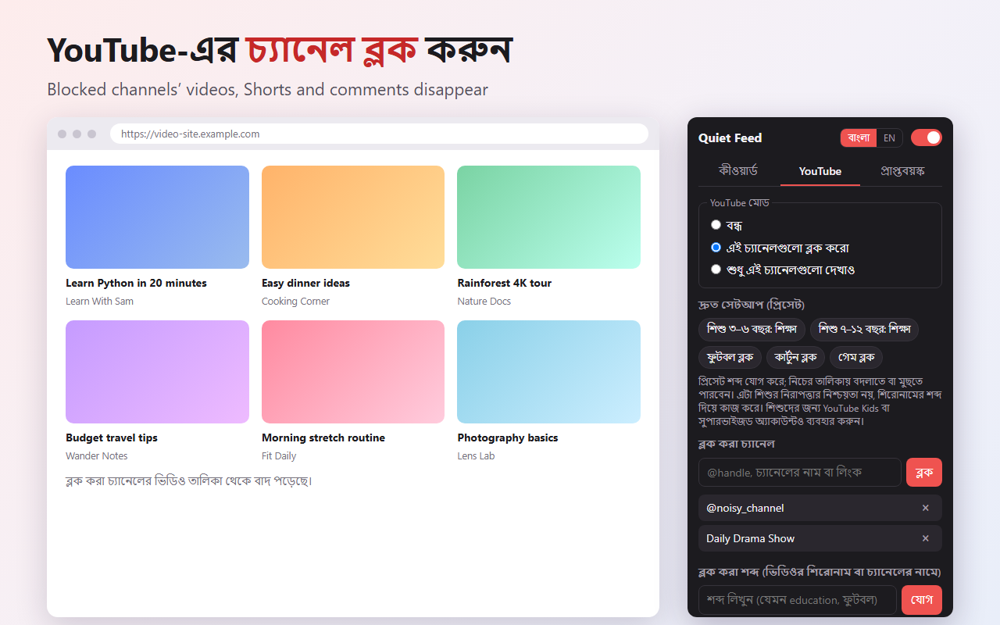
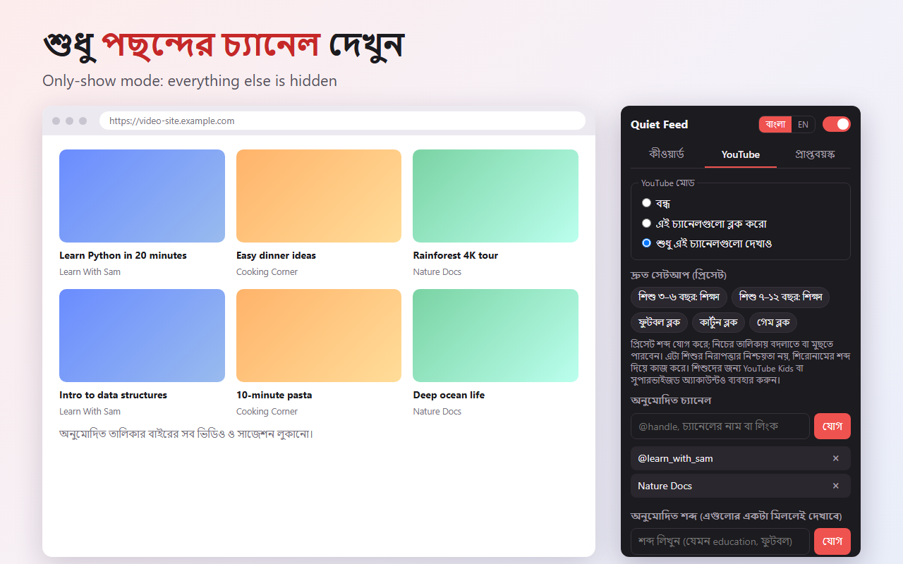

# Quiet Feed – Keyword & Channel Filter

**বাংলা | [English](README.en.md)**

<p align="center">
  <b>সব প্রধান browser-এ কাজ করে</b><br>
  
  
  
  
  
  
  <br>
  <sub>Chrome, Edge, Brave, Opera, Vivaldi ও Arc একই ZIP দিয়ে চলে (সব Chromium-ভিত্তিক)। Firefox-এর জন্য আলাদা ZIP।</sub>
</p>


আপনার দেওয়া নাম বা কীওয়ার্ড যে পোস্ট, কমেন্ট, লেখা বা ছবিতে আছে, সেগুলো সব ওয়েবসাইটে লুকিয়ে দেয়। YouTube-এর চ্যানেলও ব্লক করা যায়। সব কাজ আপনার browser-এর ভেতরেই হয়। কোনো ডেটা কোথাও যায় না।


## ডাউনলোড

আপনার browser-এর জন্য **একটা** ফাইল নিন:

| আপনার browser | ডাউনলোড |
|---|---|
| **Chrome, Edge, Brave, Opera, Vivaldi, Arc** (সব Chromium-ভিত্তিক) | **[⬇ quiet-feed-chromium.zip](https://github.com/bulbuljessore/Quiet-Feed/releases/latest/download/quiet-feed-chromium.zip)** |
| **Firefox** | **[⬇ quiet-feed-firefox.zip](https://github.com/bulbuljessore/Quiet-Feed/releases/latest/download/quiet-feed-firefox.zip)** |

নিশ্চিত না হলে: আপনার browser Firefox হলে Firefox ফাইল, বাকি সব browser-এর জন্য Chromium ফাইল। ইনস্টলের ধাপ নিচে। দরকারি সবকিছু এই ZIP-এর ভেতরেই আছে; রিপোর অন্য ফোল্ডারগুলো সোর্স কোড, সরাসরি ইনস্টল করার জন্য নয়।

## কী কী করে
- **কীওয়ার্ড ফিল্টার:** Facebook, X, Reddit, ব্লগ, নিউজ সাইটসহ যেকোনো পেজে আপনার তালিকার শব্দ থাকলে সেই পোস্ট, কমেন্ট বা লেখা লুকিয়ে যায়। বাংলা ও ইংরেজি দুটোই চলে।
- **ছবির ভেতরের লেখা:** বাংলা ও ইংরেজি OCR দিয়ে ছবির লেখা পড়ে, মিললে ছবি লুকায়। সব কাজ আপনার কম্পিউটারেই হয়।
- **YouTube শব্দ ও প্রিসেট:** শুধু চ্যানেল নয়, ভিডিওর শিরোনাম বা চ্যানেলের নামের শব্দ দিয়েও ব্লক বা অনুমোদন করা যায়। "শুধু এগুলো দেখাও" মোডে `education`, `শিক্ষা` ধরনের শব্দ দিলে শুধু সেগুলো মেলা ভিডিও দেখায়, আর `football`, `cartoon`-এর মতো ব্লক করা শব্দ সবসময় জেতে। এক ক্লিকের প্রিসেট: শিশু ৩–৬ বছর শিক্ষা, শিশু ৭–১২ বছর শিক্ষা, ফুটবল/কার্টুন/গেম ব্লক। এটা শিরোনামের শব্দ দিয়ে কাজ করে, তাই শিশুর নিরাপত্তার নিশ্চয়তা নয়; শিশুদের জন্য YouTube Kids বা সুপারভাইজড অ্যাকাউন্টও ব্যবহার করুন।
- **YouTube চ্যানেল ব্লক:** ব্লক করা চ্যানেলের ভিডিও, Shorts, কমেন্ট ও চ্যানেল পেজ আর দেখা যায় না।
- **YouTube-এ "শুধু এগুলো দেখাও" মোড:** পছন্দের চ্যানেল বেছে নিন, বাকি সব লুকিয়ে যাবে।
- **Related কনটেন্ট নিয়ন্ত্রণ:** ব্লক করা চ্যানেলের নাম শিরোনামে থাকা ভিডিও লুকানো যায়। শুধু-দেখাও মোডে "Related" সাইডবার রাখা বা লুকানো যায়।
- **ঝাপসা মোড:** সব সাইটে বা বাছাই করা সাইটে ছবি ও ভিডিও ঝাপসা থাকে, ক্লিক করলে সেটা দেখা যায়।
- **প্রাপ্তবয়স্ক কনটেন্ট ফিল্টার (ঐচ্ছিক):** প্রাপ্তবয়স্ক শব্দ (ইংরেজি ও বাংলা) থাকা পোস্ট, কমেন্ট, লেখা ও ছবির লেখা লুকায়, নাম বা শিরোনামে মিললে YouTube-এর ভিডিও ও চ্যানেলও লুকায়, পরিচিত প্রাপ্তবয়স্ক ওয়েবসাইট ব্লক করে, আর Google, Bing ও DuckDuckGo-তে SafeSearch চালু রাখে। **প্রাপ্তবয়স্ক** ট্যাব থেকে চালু করুন। এটা আপনার নিজের ফিল্টার থেকে আলাদা, তাই চালু বা বন্ধ করলে সেগুলো প্রভাবিত হয় না। লুকানো জিনিসে ডিফল্টভাবে **দেখুন** বাটন থাকে, আর ব্লক করা সাইটে **তবুও দেখুন**; কড়া মোডের জন্য এই অপশন বন্ধ করা যায়।
- **আপডেটের বিজ্ঞপ্তি:** GitHub-এ নতুন সংস্করণ এলে popup-এ ব্যানার আর আইকনে NEW চিহ্ন দেখায়।
- **বাংলা / ইংরেজি ইন্টারফেস:** popup-এর ভাষা যেকোনো সময় বদলানো যায়।
- YouTube-এর ভিডিও বা চ্যানেল পেজ থেকে এক ক্লিকে চ্যানেল যোগ।

| YouTube ব্লক | শুধু-দেখাও মোড | ছবির লেখা |
|---|---|---|
|  |  |  |

## ইনস্টল (Chrome, Edge, Brave, Opera, Vivaldi, Arc)
এই Extension এখনো কোনো স্টোরে নেই, তাই নিজে লোড করতে হয়। এতে ২ মিনিট লাগে।

1. **Chromium ZIP** ডাউনলোড করুন (উপরের বাটন, অথবা [Releases](../../releases) পেজের `quiet-feed-chromium.zip`)।
2. ZIP-টা একটা ফোল্ডারে **Extract** করুন। (ZIP সরাসরি লোড হয় না; ফোল্ডারটা এমন জায়গায় রাখুন যেখান থেকে পরে মুছবেন না।)
3. Browser-এ Extensions পেজ খুলুন:
   - Chrome: `chrome://extensions`
   - Edge: `edge://extensions`
   - Brave: `brave://extensions`
   - Opera: `opera://extensions`
   - Vivaldi: `vivaldi://extensions`
4. **Developer mode** চালু করুন।
5. **Load unpacked** চেপে Extract করা ফোল্ডারটা সিলেক্ট করুন।
6. টুলবারের Extensions (পাজল) আইকন থেকে **Quiet Feed** পিন করুন।

> Chrome মাঝে মাঝে "Disable developer mode extensions" বার্তা দেখাতে পারে। সেটা স্টোরের বাইরের সব Extension-এর জন্যই আসে; বার্তাটা বন্ধ (dismiss) করে দিলেই চলে।

## ইনস্টল (Firefox)
Firefox-এ স্টোরের বাইরের Extension শুধু **অস্থায়ীভাবে** (browser বন্ধ করলে চলে যায়) লোড হয়।

1. **Firefox ZIP** ডাউনলোড করুন (উপরের বাটন, অথবা Releases পেজের `quiet-feed-firefox.zip`)।
2. Firefox-এ `about:debugging#/runtime/this-firefox` খুলুন।
3. **Load Temporary Add-on...** চেপে ZIP ফাইলটা (বা Extract করা ফোল্ডারের `manifest.json`) সিলেক্ট করুন।
4. সব ওয়েবসাইটে অ্যাক্সেসের অনুমতি দিন।

স্থায়ীভাবে চালাতে চাইলে Firefox Developer Edition বা Nightly-তে `xpinstall.signing.required` অপশনটা `false` করতে হয়।

## ব্যবহার
- Extension-এর আইকনে ক্লিক করুন।
- **কীওয়ার্ড** ট্যাবে নাম বা শব্দ লিখে "যোগ করুন" চাপুন। সাথে সাথে সব ট্যাবে কাজ শুরু হয়।
- **YouTube** ট্যাবে মোড বেছে নিন: বন্ধ, ব্লক, অথবা শুধু-দেখাও। চ্যানেল যোগ করতে `@handle`, চ্যানেলের নাম বা লিংক দিন।
- ভিডিও বা চ্যানেল পেজে থাকলে নিচের বাটন থেকে এক ক্লিকে ওই চ্যানেল যোগ করা যায়।
- ঝাপসা মোড কীওয়ার্ড ট্যাবের নিচে।
- popup-এর উপরে **EN** চাপলে ইংরেজি, **বাংলা** চাপলে আবার বাংলা হয়। পছন্দটা মনে থাকে।

## গোপনীয়তা
- কোনো অ্যাকাউন্ট, ট্র্যাকিং, বিজ্ঞাপন বা নিজস্ব সার্ভার নেই।
- Extension নিজে থেকে শুধু একটা ঐচ্ছিক অনুরোধ পাঠায়: নতুন সংস্করণ আছে কিনা দেখতে প্রায় প্রতি ১২ ঘণ্টায় GitHub-এর পাবলিক API-তে একটা অজ্ঞাতনামা অনুরোধ। এতে কোনো ব্যক্তিগত তথ্য যায় না, আর popup থেকে এটা বন্ধ করা যায়।
- আপনার তালিকা শুধু browser-এর নিজের storage-এ থাকে।
- ছবির লেখা পড়া আপনার ডিভাইসেই হয়। কোনো ছবি বা পেজের তথ্য বাইরে যায় না।
- সব ওয়েবসাইটের অ্যাক্সেস দরকার হয়, কারণ ফিল্টার যেকোনো সাইটে চলে। বিস্তারিত: [PRIVACY-POLICY](store/PRIVACY-POLICY.md)।

## আপডেট করা
স্টোরে থাকলে Extension নিজে নিজে আপডেট হতো, কিন্তু ZIP থেকে লোড করা Extension নিজে আপডেট হতে পারে না। তাই নতুন [Release](../../releases) এলে Quiet Feed popup-এ **আপডেট ব্যানার** আর আইকনে **NEW** চিহ্ন দেখায়। আপডেট করতে:
1. Releases থেকে নতুন ZIP নামান।
2. আগের ফোল্ডারের উপর Extract করুন (ফাইল বদলে দিন)।
3. Extensions পেজে Quiet Feed-এর **Reload** চাপুন। (Firefox-এ `about:debugging` থেকে নতুন ZIP আবার লোড করুন।)

আপনার কীওয়ার্ড ও সেটিংস থেকে যায়।

## সীমাবদ্ধতা
- প্রাপ্তবয়স্ক ফিল্টারে আলাদা আলাদা YouTube চ্যানেলের তালিকা নেই; চ্যানেলের নাম ও ভিডিওর শিরোনামে প্রাপ্তবয়স্ক শব্দ মিললে লুকায়। এটা শব্দ ও সাইটের তালিকা দিয়ে কাজ করে, ছবি দেখে চেনে না। তাই কিছু কনটেন্ট বাদ পড়তে পারে, আবার তালিকার শব্দ থাকা সাধারণ পোস্টও ভুলে লুকাতে পারে। ছবির জন্য ঝাপসা মোড ব্যবহার করুন।
- SafeSearch সার্চ লিংক বদলে চালু করা হয়; সার্চ ইঞ্জিন চাইলে এর আচরণ বদলাতে পারে।
- ছবির OCR নিখুঁত না। ঝাপসা, ছোট বা অলংকৃত ফন্টের লেখা ধরতে নাও পারে।
- CSS `background-image` হিসেবে বসানো ছবি OCR বা ঝাপসা মোডে ধরা পড়ে না।
- YouTube মাঝে মাঝে পেজের গঠন বদলায়। কিছু না লুকালে [Issue](../../issues) খুলে জানান।
- Firefox-এ ছবির OCR কম পরীক্ষা করা হয়েছে।

## নিজে বানাতে (ডেভেলপারদের জন্য)
```bash
git clone https://github.com/bulbuljessore/Quiet-Feed.git
cd Quiet-Feed
node build.js        # dist/ ফোল্ডারে Chromium ও Firefox ZIP তৈরি করে
```
- রিপোর মূল ফোল্ডার সরাসরি Chromium-এ **Load unpacked** করা যায়।
- `install/chromium/` ও `install/firefox/` হলো সরাসরি লোড করার তৈরি ফোল্ডার (`node build.js` বানায়)। `build-firefox/`-এ শুধু Firefox-এর আলাদা দুটো সোর্স ফাইল আছে, ওটা ইনস্টল করার জন্য নয়।
- Node.js ১৮ বা তার পরের সংস্করণ লাগে। Windows-এ ZIP বানাতে `tar.exe` (Windows 10+ এ থাকে) ব্যবহার হয়।
- স্ক্রিনশট আবার বানাতে: `cd store/screenshots && node gen.js` (Microsoft Edge লাগে)।

## ব্যবহার নিয়ে
এটা নিজের ফিডে কী দেখবেন তা ঠিক করার ব্যক্তিগত টুল। অন্যের ক্ষতি বা হয়রানির কাজে ব্যবহার করবেন না।

## লাইসেন্স
[MIT](LICENSE)। ছবির লেখা পড়ার জন্য ব্যবহৃত Tesseract-সংক্রান্ত ফাইলগুলো Apache-2.0 লাইসেন্সের, দেখুন [THIRD-PARTY-NOTICES.md](THIRD-PARTY-NOTICES.md)।
