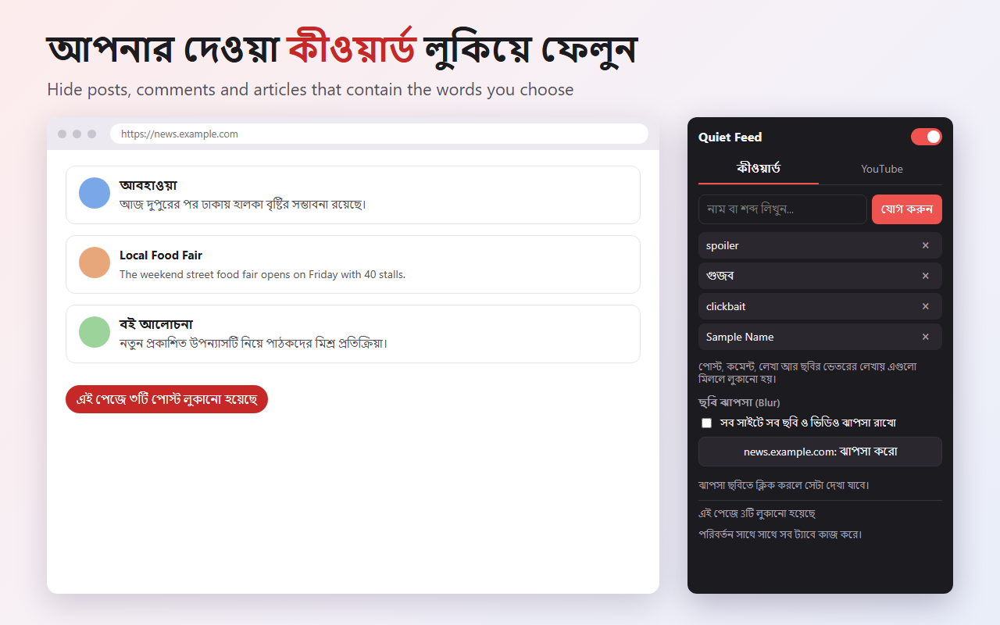
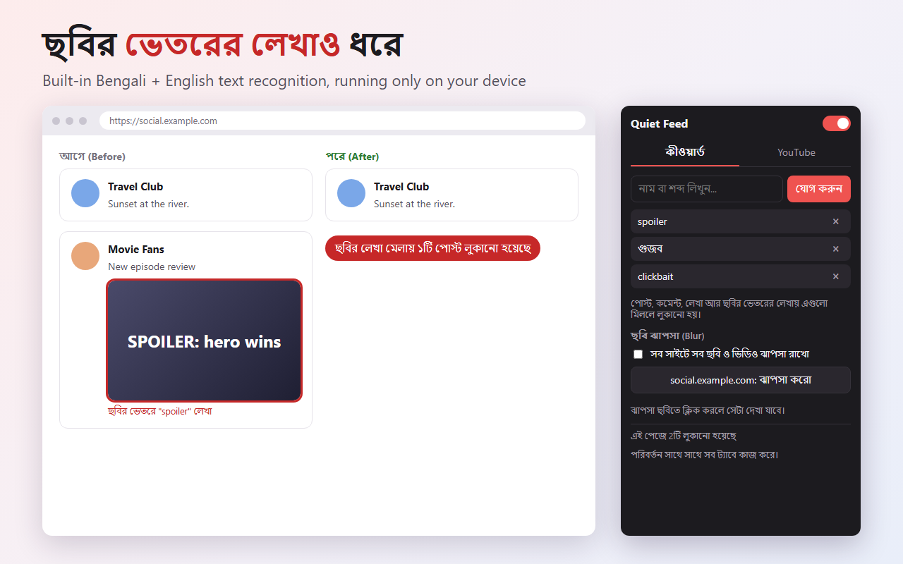

# Quiet Feed – Keyword & Channel Filter

**বাংলা | [English](#english)**

আপনার দেওয়া নাম বা কীওয়ার্ড যে পোস্ট, কমেন্ট, লেখা বা ছবিতে আছে, সেগুলো সব ওয়েবসাইটে লুকিয়ে দেয়। YouTube-এর চ্যানেলও ব্লক করা যায়। সব কাজ আপনার browser-এর ভেতরেই হয়। কোনো ডেটা কোথাও যায় না।



## কী কী করে
- **কীওয়ার্ড ফিল্টার:** Facebook, X, Reddit, ব্লগ, নিউজ সাইটসহ যেকোনো পেজে আপনার তালিকার শব্দ থাকলে সেই পোস্ট, কমেন্ট বা লেখা লুকিয়ে যায়। বাংলা ও ইংরেজি দুটোই চলে।
- **ছবির ভেতরের লেখা:** বাংলা ও ইংরেজি OCR দিয়ে ছবির লেখা পড়ে, মিললে ছবি লুকায়। সব কাজ আপনার কম্পিউটারেই হয়।
- **YouTube চ্যানেল ব্লক:** ব্লক করা চ্যানেলের ভিডিও, Shorts, কমেন্ট ও চ্যানেল পেজ আর দেখা যায় না।
- **YouTube-এ "শুধু এগুলো দেখাও" মোড:** পছন্দের চ্যানেল বেছে নিন, বাকি সব লুকিয়ে যাবে।
- **Related কনটেন্ট নিয়ন্ত্রণ:** ব্লক করা চ্যানেলের নাম শিরোনামে থাকা ভিডিও লুকানো যায়। শুধু-দেখাও মোডে "Related" সাইডবার রাখা বা লুকানো যায়।
- **ঝাপসা মোড:** সব সাইটে বা বাছাই করা সাইটে ছবি ও ভিডিও ঝাপসা থাকে, ক্লিক করলে সেটা দেখা যায়।
- YouTube-এর ভিডিও বা চ্যানেল পেজ থেকে এক ক্লিকে চ্যানেল যোগ।

| YouTube ব্লক | শুধু-দেখাও মোড | ছবির লেখা |
|---|---|---|
|  |  |  |

## ইনস্টল (Chrome, Edge, Brave, Opera, Vivaldi, Arc)
এই Extension এখনো কোনো স্টোরে নেই, তাই নিজে লোড করতে হয়। এতে ২ মিনিট লাগে।

1. [Releases](../../releases) পেজ থেকে `quiet-feed-chromium-*.zip` ডাউনলোড করুন।
2. ZIP-টা একটা ফোল্ডারে **Extract** করুন। (ZIP সরাসরি লোড হয় না; ফোল্ডারটা এমন জায়গায় রাখুন যেখান থেকে পরে মুছবেন না।)
3. Browser-এ Extensions পেজ খুলুন:
   - Chrome: `chrome://extensions`
   - Edge: `edge://extensions`
   - Brave: `brave://extensions`
   - Opera: `opera://extensions`
   - Vivaldi: `vivaldi://extensions`
4. **Developer mode** চালু করুন।
5. **Load unpacked** চেপে Extract করা ফোল্ডারটা সিলেক্ট করুন।
6. টুলবারের Extensions (পাজল) আইকন থেকে **Quiet Feed** পিন করুন।

> Chrome মাঝে মাঝে "Disable developer mode extensions" বার্তা দেখাতে পারে। সেটা স্টোরের বাইরের সব Extension-এর জন্যই আসে; বার্তাটা বন্ধ (dismiss) করে দিলেই চলে।

## ইনস্টল (Firefox)
Firefox-এ স্টোরের বাইরের Extension শুধু **অস্থায়ীভাবে** (browser বন্ধ করলে চলে যায়) লোড হয়।

1. Releases থেকে `quiet-feed-firefox-*.zip` ডাউনলোড করুন।
2. Firefox-এ `about:debugging#/runtime/this-firefox` খুলুন।
3. **Load Temporary Add-on...** চেপে ZIP ফাইলটা (বা Extract করা ফোল্ডারের `manifest.json`) সিলেক্ট করুন।
4. সব ওয়েবসাইটে অ্যাক্সেসের অনুমতি দিন।

স্থায়ীভাবে চালাতে চাইলে Firefox Developer Edition বা Nightly-তে `xpinstall.signing.required` অপশনটা `false` করতে হয়।

## ব্যবহার
- Extension-এর আইকনে ক্লিক করুন।
- **কীওয়ার্ড** ট্যাবে নাম বা শব্দ লিখে "যোগ করুন" চাপুন। সাথে সাথে সব ট্যাবে কাজ শুরু হয়।
- **YouTube** ট্যাবে মোড বেছে নিন: বন্ধ, ব্লক, অথবা শুধু-দেখাও। চ্যানেল যোগ করতে `@handle`, চ্যানেলের নাম বা লিংক দিন।
- ভিডিও বা চ্যানেল পেজে থাকলে নিচের বাটন থেকে এক ক্লিকে ওই চ্যানেল যোগ করা যায়।
- ঝাপসা মোড কীওয়ার্ড ট্যাবের নিচে।

## গোপনীয়তা
- কোনো অ্যাকাউন্ট, ট্র্যাকিং, বিজ্ঞাপন বা সার্ভার নেই।
- আপনার তালিকা শুধু browser-এর নিজের storage-এ থাকে।
- ছবির লেখা পড়া আপনার ডিভাইসেই হয়। কোনো ছবি বা পেজের তথ্য বাইরে যায় না।
- সব ওয়েবসাইটের অ্যাক্সেস দরকার হয়, কারণ ফিল্টার যেকোনো সাইটে চলে। বিস্তারিত: [PRIVACY-POLICY](store/PRIVACY-POLICY.md)।

## সীমাবদ্ধতা
- ছবির OCR নিখুঁত না। ঝাপসা, ছোট বা অলংকৃত ফন্টের লেখা ধরতে নাও পারে।
- CSS `background-image` হিসেবে বসানো ছবি OCR বা ঝাপসা মোডে ধরা পড়ে না।
- YouTube মাঝে মাঝে পেজের গঠন বদলায়। কিছু না লুকালে [Issue](../../issues) খুলে জানান।
- Firefox-এ ছবির OCR কম পরীক্ষা করা হয়েছে।

## নিজে বানাতে (ডেভেলপারদের জন্য)
```bash
git clone <এই রিপোর লিংক>
cd <রিপো ফোল্ডার>
node build.js        # dist/ ফোল্ডারে Chromium ও Firefox ZIP তৈরি করে
```
- রিপোর মূল ফোল্ডার সরাসরি Chromium-এ **Load unpacked** করা যায়।
- Firefox সংস্করণের manifest আর background আছে `firefox/` ফোল্ডারে।
- Node.js ১৮ বা তার পরের সংস্করণ লাগে। Windows-এ ZIP বানাতে `tar.exe` (Windows 10+ এ থাকে) ব্যবহার হয়।
- স্ক্রিনশট আবার বানাতে: `cd store/screenshots && node gen.js` (Microsoft Edge লাগে)।

## ব্যবহার নিয়ে
এটা নিজের ফিডে কী দেখবেন তা ঠিক করার ব্যক্তিগত টুল। অন্যের ক্ষতি বা হয়রানির কাজে ব্যবহার করবেন না।

## লাইসেন্স
[MIT](LICENSE)। ছবির লেখা পড়ার জন্য ব্যবহৃত Tesseract-সংক্রান্ত ফাইলগুলো Apache-2.0 লাইসেন্সের, দেখুন [THIRD-PARTY-NOTICES.md](THIRD-PARTY-NOTICES.md)।

---

## English

**Quiet Feed** hides posts, comments, articles and images that contain the names or keywords you choose, on any website. It can also block YouTube channels or show only the channels you pick. Everything runs inside your browser; no data leaves your device.

### Features
- Keyword filter for posts, comments and articles (Bengali and English)
- Text-in-image detection using bundled on-device OCR (Bengali + English)
- YouTube channel blocker, "only show these channels" mode, related-content control
- Blur mode: blur all images/videos (everywhere or on chosen sites), click to reveal
- One-click add of the current YouTube channel

### Install (Chrome, Edge, Brave, Opera, Vivaldi, Arc)
1. Download `quiet-feed-chromium-*.zip` from [Releases](../../releases) and **extract** it.
2. Open your browser's extensions page (`chrome://extensions`, `edge://extensions`, ...).
3. Turn on **Developer mode**.
4. Click **Load unpacked** and select the extracted folder.

### Install (Firefox)
Unsigned add-ons load temporarily in Firefox: download `quiet-feed-firefox-*.zip`, open `about:debugging#/runtime/this-firefox`, click **Load Temporary Add-on...** and pick the ZIP. It is removed when Firefox closes (Developer Edition/Nightly can keep it by setting `xpinstall.signing.required` to `false`).

### Build from source
```bash
node build.js   # creates dist/quiet-feed-chromium-<version>.zip and dist/quiet-feed-firefox-<version>.zip
```

### Privacy
No accounts, analytics, ads or servers. Lists are stored in your browser's extension storage. See [PRIVACY-POLICY](store/PRIVACY-POLICY.md).

### License
MIT. Bundled OCR components are Apache-2.0; see [THIRD-PARTY-NOTICES.md](THIRD-PARTY-NOTICES.md).
